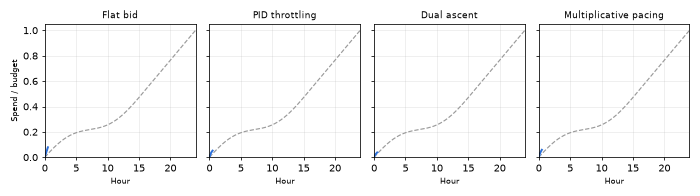

# PacerLab: Auto-Bidding & Budget Pacing Simulator

An open-source ad auction simulator that compares auto-bidding and budget-pacing algorithms (PID control, dual-based online learning, multiplicative pacing) on spend smoothness and ROI.



**Benchmark**: 10,000,000 simulated auctions per strategy, second-price rule, budget = 35% of unconstrained spend, seed 7. All four strategies ran in about 1 second in total (measured on a dev machine; the exact time varies). Spend RMSE is the root-mean-square gap between cumulative spend and the target curve, as a fraction of budget.

| Strategy | Spend RMSE | Error vs flat | Max dev | Budget used | Win rate | ROAS |
|---|---|---|---|---|---|---|
| Flat bid | 0.3849 | baseline | 0.645 | 100.0% | 26.2% | 2.05 |
| PID throttling | 0.0043 | -98.9% | 0.025 | 100.0% | 24.2% | 1.95 |
| Dual ascent | 0.0120 | -96.9% | 0.015 | 100.0% | 25.2% | 2.93 |
| Multiplicative pacing | 0.0120 | -96.9% | 0.032 | 100.0% | 24.9% | 2.67 |

The flat bidder exhausts its budget at 53% of the day. PID tracks the curve most tightly, while dual ascent keeps the tightest worst-case deviation and earns about 43% more ROAS than flat (2.93 vs 2.05). Numbers are for this synthetic scenario with default gains; reproduce them with `python scripts/make_readme_assets.py` (also regenerates the GIF).

## Features

- **Synthetic traffic**: inhomogeneous-Poisson arrivals with a two-harmonic daily cycle (evening peak plus lunchtime bump), per-query-class lognormal values, and competitor top-bids that are correlated with value and rise at traffic peaks.
- **C++ auction engine**: first-price and second-price rules, optional reserve price, hard budget cap (a win the remaining budget can't cover is not taken), ties go to the competitor.
- **Four strategies behind one interface** (`Strategy` in C++, a dataclass per algorithm in Python):
  | Strategy | Mechanism |
  |---|---|
  | Flat bid | bids `base_mult × value` until the budget is gone (baseline) |
  | PID throttling | bids normally but enters each auction with probability `rate`, steered by a PID loop on the spend error (anti-windup included) |
  | Dual ascent | bid = `value / (1 + λ)`, λ updated by projected subgradient ascent on the budget constraint |
  | Multiplicative pacing | bid multiplier scaled by `exp(gain × error)` each interval |
- **Evaluation harness**: budget utilization, spend-curve deviation from target (RMSE and max, as a fraction of budget), win rate, total conversion value, ROAS, and the time the budget is exhausted. Seeded and reproducible; multi-seed aggregation (mean/std).
- **Streamlit dashboard**: side-by-side cumulative-spend-vs-target plots for each strategy, a metrics table, and controls for scenario and controller gains.

## Architecture

```
cpp/include/pacerlab/   rng, Strategy interface + factory, simulator API
cpp/src/                strategy.cpp (algorithms), simulator.cpp (auction loop), bindings.cpp (pybind11)
cpp/tests/              GoogleTest unit tests
python/pacerlab/        traffic.py, strategies.py, evaluation.py, plotting.py, cli.py, config.py
app/streamlit_app.py    dashboard
tests/                  pytest suite (engine via bindings, traffic, harness)
```

Data flow: `generate_traffic` (NumPy) → `evaluation.run` passes zero-copy arrays to `_core.run` → the C++ loop asks the strategy for a bid per auction, resolves the auction, and calls `on_bucket_end` once per control interval → per-bucket spend/value/win arrays come back as NumPy → `RunResult.metrics()` (pandas).

## Setup

Requires Python ≥ 3.9 and a C++17 compiler (g++/clang).

```bash
python3 -m venv .venv && source .venv/bin/activate
pip install -e ".[dev,ui]"      # compiles the C++ extension
```

## Run

```bash
python -m pacerlab                                # compare all strategies (second price)
python -m pacerlab --rule first_price --plot spend.png
python -m pacerlab --runs 10                      # mean/std over 10 traffic seeds
streamlit run app/streamlit_app.py                # dashboard on http://localhost:8501
python scripts/make_readme_assets.py              # 10M-auction benchmark table + GIF
```

**60-second demo script** (dashboard): (1) open the app, all four panels show cumulative spend vs. the dashed target; flat bid peels away and flatlines at midday. (2) In the sidebar, narrow "Strategies shown" to *Flat bid* and *Dual ascent*, then back to all. (3) Drag "Budget / unconstrained spend" down to 0.15 and up to 0.6 to show pacers adapting. (4) Switch to `first_price` and show ROAS and shading change. (5) Raise "Dual-ascent step size" to 2.0 to show the controller oscillating when over-tuned.

Defaults can be set via environment variables (see `.env.example`; nothing is required, no secrets are used): `PACERLAB_N_AUCTIONS`, `PACERLAB_N_BUCKETS`, `PACERLAB_BUDGET_RATIO`, `PACERLAB_AUCTION_RULE`, `PACERLAB_SEED`. Export them in your shell; the app does not load `.env` files itself.

Quick sample (300k auctions, same scenario):

```
                       budget_utilization  spend_rmse  spend_max_dev  win_rate  total_value    roas  budget_exhausted_at
Flat bid                           1.0000      0.3824         0.6452    0.2627     121230.25  2.043               0.5347
PID throttling                     1.0000      0.0043         0.0256    0.2420     115659.86  1.949               1.0000
Dual ascent                        1.0000      0.0120         0.0148    0.2514     174017.00  2.929               0.9931
Multiplicative pacing              0.9915      0.0122         0.0323    0.2473     157993.06  2.682               0.9993
```

The flat bidder burns its budget by mid-day (53%); every pacer tracks the target within ~1% RMSE. Bid-modifying pacers (dual, multiplicative) also win the cheaper auctions and so reach higher ROAS than throttling, which skips auctions at random regardless of their quality.

## Test

```bash
pytest                                            # Python suite (engine, traffic, strategies, harness)

# C++ unit tests (CMake from `pip install cmake` works; GoogleTest is downloaded once)
cmake -S . -B build && cmake --build build -j && ctest --test-dir build --output-on-failure
```

## Key design decisions

- **Strategies run inside C++.** A Python callback per auction would cap throughput at ~1M/s; instead Python selects a strategy by name plus a parameter dictionary and the factory validates it (unknown strategy/parameter names throw).
- **One control interval.** Feedback controllers update at bucket boundaries (default 288 per day = 5 minutes), mirroring how production pacers act on delayed spend reports. Within a bucket the bid rule is fixed.
- **Target curve.** By default the target is proportional to the cumulative share of traffic (a perfect traffic forecast, i.e. an oracle); even-over-the-day pacing is available via `compare(..., target_kind="linear")` and the dashboard. Real systems would substitute a forecast, which is a natural extension.
- **Budget scale.** Budget is expressed as a ratio of what the flat bidder would spend with no cap, so the budget always binds comparably across settings.
- **Value model.** `value` is the expected conversion value (pCVR × value per conversion) of an impression, not a sampled Bernoulli outcome, which keeps ROAS comparisons low-variance. Impressions are assumed to be a single advertiser vs. one aggregated highest competing bid.
- **First price.** All strategies share a `base_mult` bid shade (0.6 by default under first price in the default line-up); with no shading a first-price bidder at `bid = value` earns ROAS exactly 1. Dual ascent additionally shades dynamically through λ.
- **Determinism.** Traffic uses `numpy.random.default_rng(seed)`; throttling uses a SplitMix64 generator seeded per run (not `std::` distributions, whose output differs across standard libraries).
- **Default gains** were tuned on the default scenario (see `strategies.py`); they are reasonable but not optimal for every traffic shape, and the dashboard exposes them.

## Limitations

Single advertiser against an exogenous competitor price (no strategic interaction), no learning of the traffic forecast, no ROI/CPA constraints (only a budget constraint), conversions are expectations.

## Design decisions & roadmap

*Written as the lead would put it to the team.*

**What we decided and why.** We put the auction loop and all strategies in C++ because the question we care about, "how does a controller behave over millions of impressions across many seeds and budgets", is only answerable if a run takes about a second, not minutes. Python stays in charge of everything that changes weekly: traffic models, metrics and the UI. We chose one narrow interface (`bid()` per auction, `on_bucket_end()` per control interval) so a new algorithm is about 30 lines and is automatically comparable on the same traffic, budget and target.

**Trade-offs we accepted.**
- *Oracle target curve.* The target uses the actual traffic shape, which flatters every pacer. It isolates controller quality from forecasting quality, but it overstates what production would see. Reported errors are a lower bound.
- *Single advertiser vs. one aggregated competitor price.* Fast and reproducible, but no strategic reaction: if every advertiser paced, prices would shift. The ranking of algorithms may not survive that.
- *Expected value, not sampled conversions.* Low-variance ROAS comparisons, but we hide the noise that makes real-world ROAS-driven control hard.
- *Hand-tuned gains.* Defaults were tuned on one scenario. The headline gap between PID and dual ascent could move with different tuning, so I would not read the ranking among the three pacers as settled; the gap to the flat baseline is large and robust.

**Risks.**
- The benchmark is synthetic, so the percentages are evidence about the algorithms in this model, not a forecast of production lift.
- PID and dual ascent are both sensitive to the control interval and the step size; over-tuned gains oscillate (the dashboard shows this). Anything shipped needs guardrails: gain clamps, a kill switch, and spend alarms.
- First-price results depend on the fixed shading factor, which is a simplification of real bid landscapes.

**What a team would build next.**
1. Replay real (or logged-and-anonymized) traffic and calibrate the generator against it, plus a forecast module so the target is predicted, not oracle.
2. Parameter sweeps and auto-tuning of gains, with multi-seed confidence intervals in the harness output (std per metric is already computed).
3. Delayed and noisy spend feedback, to model reporting lag.
4. Multi-advertiser, multi-campaign budgets with interacting pacers, and ROI/CPA constraints beyond a budget cap (the dual formulation extends naturally with one multiplier per constraint).
5. Learned bid shading for first price, and a CI job running the Python and GoogleTest suites on every change.
